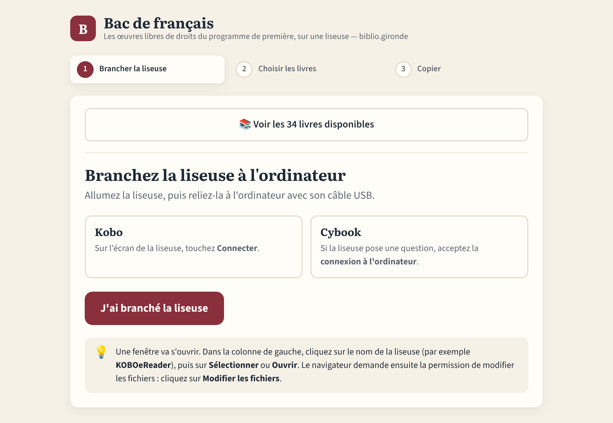

# Kit Bac de français — classiques libres



Les œuvres **libres de droits** inscrites au programme de première pour les épreuves
anticipées de français de **2020 à 2027**, et une webapp pour les copier en quelques
clics sur les liseuses du réseau (Kobo, Cybook…).

**Webapp :** https://bibliogironde.github.io/Kit-Liseuses-Classiques-au-bac/
**Application de bureau (Windows, Mac, Linux, sans internet) :** [dernière version](https://github.com/biblioGironde/Kit-Liseuses-Classiques-au-bac/releases/latest)

Ce dépôt complète le [Kit Les Classiques en numérique](https://github.com/biblioGironde/Kit-Les-Classiques-En-Numerique)
et en reprend le fonctionnement.

## Le programme couvert

Le programme national compte douze œuvres, trois par objet d'étude, renouvelées par quart
chaque année (Bulletins officiels de 2019 à 2025). Sur les 40 œuvres au programme de 2020 à
2027, **32 sont libres de droits** ; 31 figurent dans ce kit, rangées par objet d'étude :

| Objet d'étude | Œuvres libres |
|---|---|
| Poésie | Hugo, Baudelaire, Apollinaire, Rimbaud |
| Littérature d'idées | Montaigne, La Fontaine, Montesquieu, Voltaire, Rabelais, La Bruyère, Olympe de Gouges, La Boétie, Fontenelle, Graffigny |
| Roman et récit | Lafayette, Stendhal, Verne, Prévost, Balzac (×2), Colette, Zola (×2) |
| Théâtre | Racine, Beaumarchais, Molière (×2), Marivaux (×2), Corneille, Musset |

Les années de bac et la voie (générale, technologique ou les deux) sont indiquées pour
chaque titre dans `catalogue.csv`, la webapp et `SOURCES.md`.

**Non incluses car encore protégées :** Yourcenar (*Mémoires d'Hadrien*), Sarraute (*Enfance*,
*Pour un oui ou pour un non*), Beckett (*Oh les beaux jours*), Lagarce (*Juste la fin du monde*),
Ponge (*La Rage de l'expression*), Dorion (*Mes forêts*), Schwarz-Bart (*Pluie et vent sur
Télumée Miracle*).

### Points d'attention pour les lycéens

- **Montaigne, Rabelais, La Boétie** : le texte fourni est le texte ancien. Les versions en
  français modernisé utilisées en classe sont récentes et protégées.
- **Chrétien de Troyes** (*Le Chevalier de la charrette*, bac 2027) est libre mais **absent du
  kit** : Wikisource ne propose pas de texte fiable (l'édition en ancien français y mélange
  un texte de 1850 et une édition de 1989, protégée ; la version de 1922 est une adaptation
  du *Lancelot en prose*, pas l'œuvre de Chrétien). Le programme demande de toute façon
  une édition bilingue. Les éditions anciennes sont consultables sur Gallica.
- **Rimbaud** : le *Cahier de Douai* n'existe pas en volume séparé. Il correspond aux 22 poèmes
  allant de « Première soirée » à « Ma Bohème » dans les *Poésies*.
- **Colette** : *Sido* et *Les Vrilles de la vigne* sont deux fichiers séparés.
- **Graffigny** : le programme inclut des ajouts de l'édition de 1752 (introduction historique,
  lettres XXVIII, XXIX, XXX et XXXIV).
- Plusieurs œuvres ne sont au programme que **par extraits** (livres des *Fables* ou des
  *Caractères*, chapitres de *Gargantua*, soirées de Fontenelle) : la colonne `programme`
  du catalogue le précise.

## Remplir une liseuse (mode d'emploi express)

1. Ouvrir la webapp avec **Chrome** ou **Edge** sur un ordinateur.
2. Brancher la liseuse (Kobo : toucher « Connecter » sur l'écran).
3. Cliquer sur « J'ai branché la liseuse », choisir la liseuse dans la fenêtre, autoriser la modification.
4. Cocher les livres, cliquer sur « Copier ».
5. Éjecter la liseuse, débrancher.

La webapp reconnaît la liseuse et envoie le bon format :

| Liseuse | Détection | Format copié |
|---|---|---|
| Kobo | dossier système `.kobo` | KEPUB (format natif Kobo, plus fluide) |
| Cybook | nom du disque, dossiers Bookeen | EPUB |
| Autre / non reconnue | choix manuel | EPUB |

Les livres sont copiés dans un dossier `Bac de francais` sur la liseuse. Ceux qui y sont
déjà sont signalés et ne sont pas recopiés.

Également publiés :

- `liseuse.html` : version très légère à ouvrir dans le navigateur d'une liseuse
  (téléchargement à l'unité, sans ordinateur) ;
- `opds.xml` : catalogue OPDS pour KOReader et les applis de lecture ;
- `packs/` : un ZIP par objet d'étude et un ZIP complet.

## Application de bureau (sans internet)

La même webapp existe en application à installer, avec **tous les livres inclus** : pratique
dans une bibliothèque sans connexion fiable, ou sur un ordinateur où Chrome et Edge ne sont pas
installés. Elle se télécharge depuis la page
[Releases](https://github.com/biblioGironde/Kit-Liseuses-Classiques-au-bac/releases/latest) :

| Ordinateur | Fichier |
|---|---|
| Windows | `…-windows-installation.exe` (ou `…-windows-portable.exe`, sans installation, pour une clé USB) |
| Mac (Intel et Apple Silicon) | `…-mac-universal.dmg` |
| Linux | `…-linux-x86_64.AppImage` ou `…-linux-amd64.deb` |

L'application n'est pas signée : au premier lancement, Windows affiche « Windows a protégé votre
ordinateur » (cliquer sur *Informations complémentaires › Exécuter quand même*) et macOS peut
demander une confirmation dans *Réglages Système › Confidentialité et sécurité › Ouvrir quand même*.

**Publier une nouvelle version** (par exemple après la mise à jour du programme) : changer
`version` dans `electron/package.json`, pousser, puis pousser une étiquette du même numéro :

```bash
git tag v1.1.0 && git push origin v1.1.0
```

L'action « Applications de bureau » construit les trois versions et les ajoute à la release.

Tester l'application en local : `python3 scripts/construire.py && mv site electron/site`,
puis `cd electron && npm install && npm start`.

## Organisation du dépôt

```
catalogue.csv          la liste des titres (à modifier pour ajouter un livre)
epub/poesie, epub/idees, epub/roman, epub/theatre
                       les fichiers EPUB, rangés par objet d'étude
app/index.html         la webapp
electron/              l'application de bureau (Electron), qui embarque le site construit
scripts/telecharger.py téléchargement en lot (BNR d'abord, puis Wikisource)
scripts/construire.py  génère le site : webapp, catalogue.json, KEPUB, OPDS, ZIP
SOURCES.md             provenance et licence de chaque titre (généré)
```

## Mettre à jour le programme chaque été

Le ministère publie chaque été au Bulletin officiel le programme de l'année suivante.
Pour ajouter les nouvelles œuvres libres :

1. Ajouter une ligne par œuvre dans `catalogue.csv` (colonnes `groupe`, `auteur`, `titre`,
   `annee`, `bac`, `voie`, `programme`, et si possible `wikisource`) ;
2. Allonger la colonne `bac` des œuvres maintenues (par exemple `2024-2027` → `2024-2028`) ;
3. Lancer `python3 scripts/telecharger.py`, puis pousser sur `main`.

## Ajouter ou mettre à jour des livres

Il faut Python 3.8 ou plus récent, sans bibliothèque à installer.

Le script cherche chaque titre dans cet ordre :

1. **lien direct** déjà indiqué dans la colonne `url` de `catalogue.csv` ;
2. **[Bibliothèque numérique romande](https://ebooks-bnr.com)** (BNR), dont les EPUB sont relus et soignés ;
3. **Wikisource**, via le service d'export officiel.

```bash
python3 scripts/telecharger.py --verifier            # cherche les sources sans rien télécharger
python3 scripts/telecharger.py                       # télécharge tous les EPUB manquants
python3 scripts/telecharger.py --groupe theatre      # un seul objet d'étude (poesie, idees, roman, theatre)
python3 scripts/telecharger.py --forcer              # retélécharge tout
python3 scripts/telecharger.py --source wikisource   # sans la BNR
```

Le script remplit lui-même les colonnes `source`, `page` et `url` du catalogue et affiche un
bilan. Pour chaque titre signalé « à vérifier », mettez le lien direct de l'EPUB dans la
colonne `url` ou le titre exact de la page Wikisource dans la colonne `wikisource`, puis
relancez avec `--forcer --groupe <objet d'étude>`.

Il suffit ensuite de pousser sur `main` : l'action GitHub convertit les livres au format Kobo
(avec [kepubify](https://github.com/pgaskin/kepubify)), reconstruit et publie la webapp. Les
livres de la BNR ne sont pas convertis : ses conditions demandent de les diffuser sans
modification.

Tester en local :

```bash
python3 scripts/construire.py
cd site && python3 -m http.server 8000   # puis ouvrir http://localhost:8000 dans Chrome
```

## Autres éditions libres

La colonne `autres_sources` du catalogue liste, quand elles existent, d'autres éditions
vérifiées titre par titre : [Ebooks libres et gratuits](https://www.ebooksgratuits.com),
[Bibebook](https://www.bibebook.com) et [Project Gutenberg](https://www.gutenberg.org/browse/languages/fr).
Elles ne sont pas hébergées dans le dépôt, mais `SOURCES.md` y renvoie, avec un lien de
recherche [Gallica](https://gallica.bnf.fr) pour montrer les éditions anciennes en médiation.

## Droits

- Les œuvres sont dans le domaine public en France (auteurs morts depuis plus de 70 ans ;
  Apollinaire, « mort pour la France », depuis 2013 ; Colette depuis 2025).
- Elles ont toutes été publiées avant 1931 : elles sont aussi libres aux États-Unis, où
  GitHub est hébergé.
- Les EPUB de la **BNR** peuvent être utilisés librement, **sans modification**, en indiquant
  la source ; ils sont diffusés tels quels.
- Les EPUB issus de **Wikisource** sont sous licence CC BY-SA 4.0 : la source est indiquée
  dans `SOURCES.md` et dans chaque fichier.
- Ne pas ajouter de traduction ou de version modernisée récente : elle serait protégée.

## Activer GitHub Pages (une seule fois)

Dans le dépôt : *Settings → Pages → Build and deployment → Source : GitHub Actions*.
